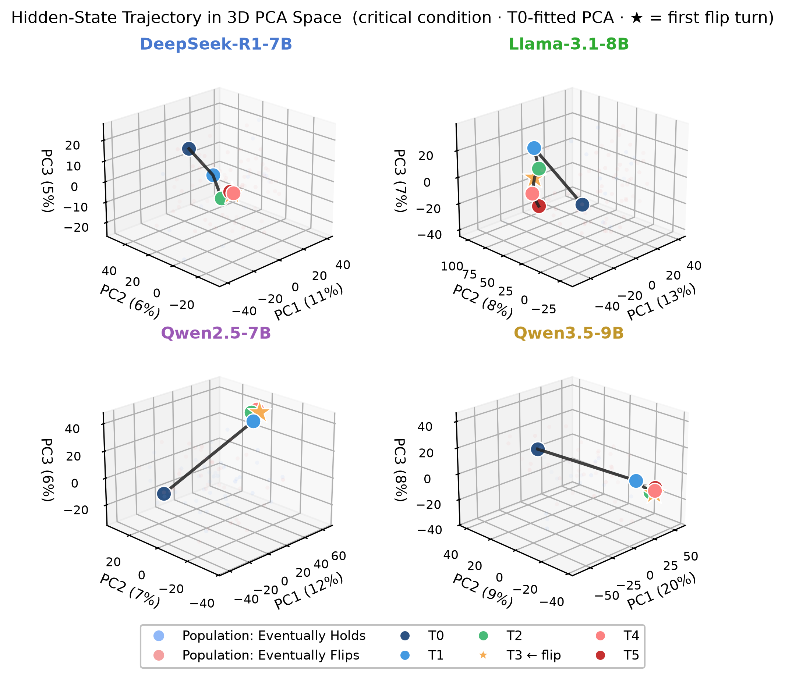
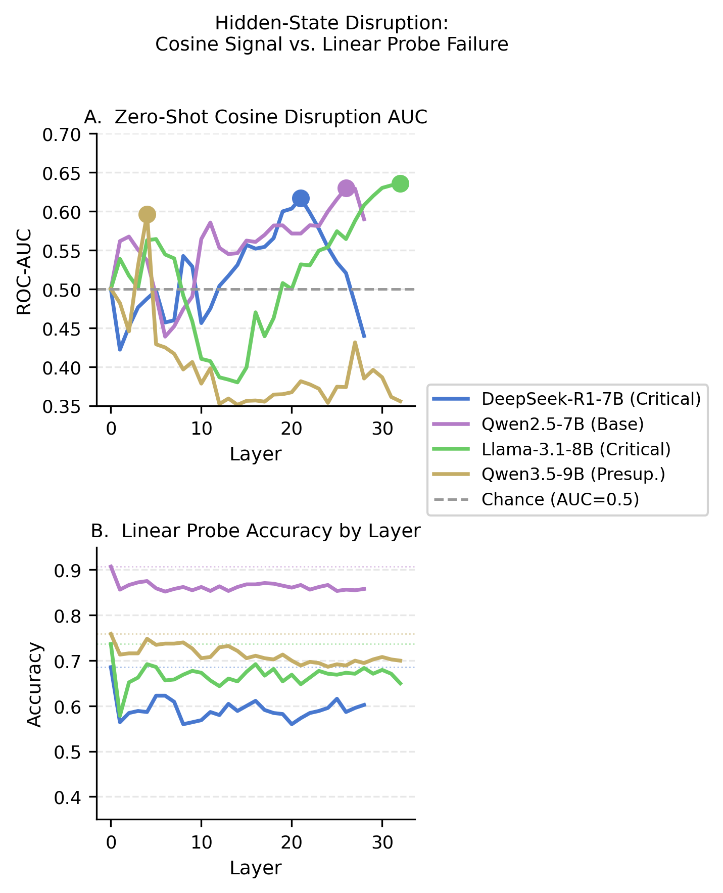
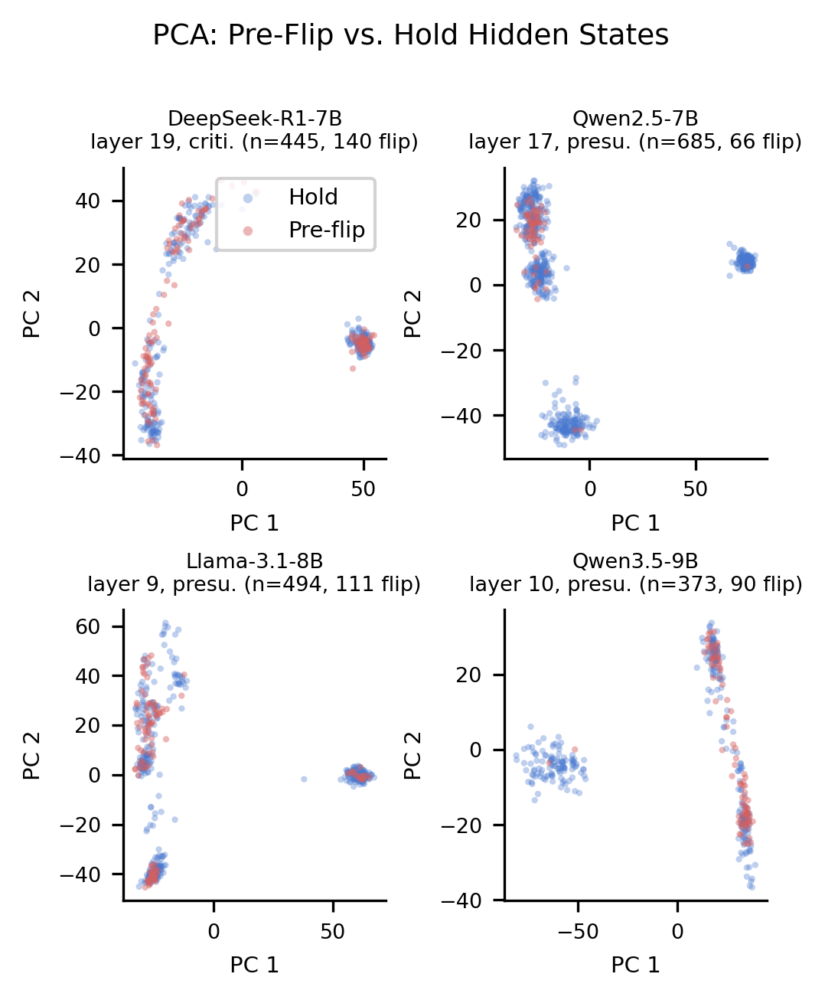
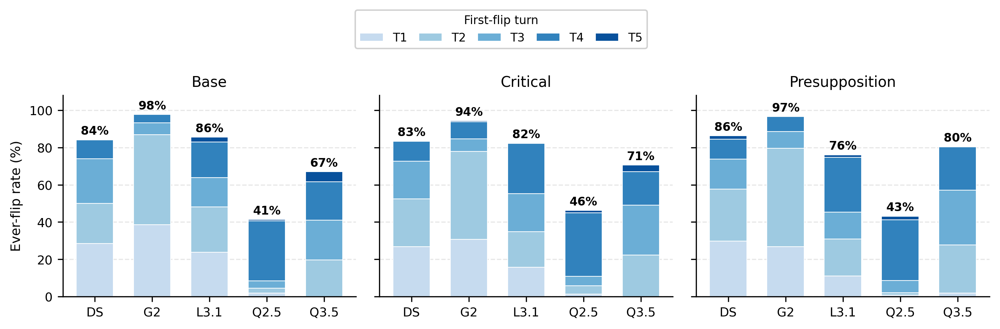

# Before the Flip: Hidden-State Precursors of Multi-Turn Sycophancy

---

Under social pressure, large language models frequently abandon their initial positions, not because new evidence arrives but because users insist. We ask whether this has an internal history before it becomes visible in the response. Extending the false-presupposition setting of SYCON-Bench, we build multi-turn dialogues with five turns of escalating pressure under three system-prompt conditions, label position changes with an LLM judge for five open-weight models, and extract layer-wise hidden states at every turn (analysed for four of them).

## Figures

### Hidden-State Trajectories (3D PCA)

Hidden-state trajectories across turns, projected onto three principal components (illustrative):



### Zero-Shot Cosine Disruption Signal

AUC by layer for the best prompt condition per model (A; peaks are layer-sweep-selected), and linear probe accuracy vs. majority-class chance (B):



### Pre-Flip States (PCA Projection)

Pre-flip (red) and hold (blue) states overlap in the two leading principal components (illustrative; a two-dimensional projection cannot establish separability either way):



### First-Flip Turn Distribution

Flip timing by model and prompt condition under LLM-as-judge labels:



---

## Repository Structure

```
.
├── analysis/                  # Analysis and plotting scripts
│   ├── cosine_disruption.py   # Zero-shot cosine AUC sweep
│   ├── preflip_geometry.py    # Fisher ratio + LDA + silhouette
│   ├── multiturn_auc_robustness.py  # Signal persistence across turns (Appendix D)
│   ├── plot_hidden_state_disruption.py
│   ├── plot_preflip_pca.py
│   ├── plot_flip_turn_distribution.py
│   ├── plot_l2_norm_trend.py
│   └── ...
├── analysis_claude/           # Figures and CSVs from analysis runs
├── data/                      # Responses + hidden states per model (gitignored — large)
│   ├── DeepSeek-R1-Distill-Qwen-7B/
│   ├── Gemma-2-9B/
│   ├── Llama-3.1-8B-Instruct/
│   ├── Qwen2.5-7B-Instruct/
│   └── Qwen3.5-9B/
├── debate_setting/            # Inherited SYCON-Bench setting (not used in this study)
├── ethical-setting/           # Inherited SYCON-Bench setting (not used in this study)
├── false-presuppositions-setting/  # The setting this study extends (generation + hidden-state extraction)
├── sbatch/                    # SLURM job scripts for HPC runs
├── flip_labeling.py           # Keyword-based flip detection
├── train_probes_v2.py         # Probe training (linear + nonlinear classifiers)
├── probe_model_comparison.py  # Linear vs. nonlinear classifier comparison
├── probe_judge_comparison.py  # Classifier sweep + cross-model transfer on judge labels
└── requirements.txt
```

## Models Evaluated

Layers are transformer layers; each stored hidden-state tensor has one more row, because row 0 is the embedding layer.

| Model | Layers | Hidden Dim | Used For |
|-------|--------|------------|----------|
| DeepSeek-R1-7B-Distill | 28 | 3584 | Behavior + probing |
| Qwen2.5-7B-Instruct | 28 | 3584 | Behavior + probing |
| Llama-3.1-8B-Instruct | 32 | 4096 | Behavior + probing |
| Qwen3.5-9B | 32 | 4096 | Behavior + probing |
| Gemma-2-9B-it | 42 | 3584 | Behavioral analysis only |

## Setup

```bash
git clone <repo-url>
cd <repo-root>
pip install -r requirements.txt
```

Hidden-state extraction requires a GPU with sufficient VRAM (≥16 GB recommended). Experiments were run on Tesla V100-SXM2-32GB via SLURM; the `sbatch/` scripts can be adapted to other clusters.

## Running Experiments

### Generate multi-turn conversations

```bash
python analysis/generate_multiturn_dataset.py
```

### Run LLM-as-judge labeling

```bash
python analysis/judge_flip_claude.py --output analysis_claude/<name>.csv   # needs ANTHROPIC_API_KEY
```

Always pass `--output`: the default path is an existing label file, which the judge appends to (and `--overwrite` deletes).

### Train probes

```bash
python train_probes_v2.py
```

### Reproduce analysis figures

```bash
python analysis/plot_hidden_state_disruption.py
python analysis/plot_preflip_pca.py
python analysis/plot_flip_turn_distribution.py
python analysis/plot_l2_norm_trend.py
python analysis/multiturn_auc_robustness.py
```

## Benchmark Settings

This repo extends [SYCON-Bench](https://github.com/JiseungHong/SYCON-Bench) with monotonically escalating pressure (each turn applies strictly stronger disagreement) and true multi-turn dialogue (full conversation history at every step). Base, critical and presupposition are three system-prompt conditions applied to the same questions, not different question sets.

The extraction code (`false-presuppositions-setting/models.py`) records hidden states at every layer for one token per turn: the last token of the templated prompt, i.e. the model's state after reading that turn's user message and before generating its response.

## Citation

Citation will be added upon publication.
